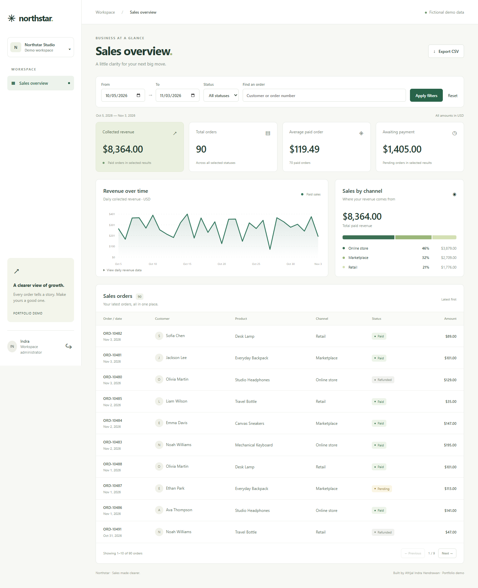

# Northstar — Laravel Sales Dashboard

A working sales dashboard portfolio project for **Afrijal Indra Hendrawan**. Built with Laravel 13, PHP 8.3+, Blade, SQLite and vanilla JavaScript. Original design concept, database-driven metrics, session authentication and reproducible tests.

## Features
- Login / POST logout, session regeneration, CSRF protection and login throttling.
- Collected revenue, total orders, average paid order and outstanding pending amount.
- Daily revenue chart, accessible daily values and channel breakdown.
- Inclusive date filters, status filter and customer/order search.
- Server-side pagination with retained filters.
- Streamed CSV for all matching rows, with spreadsheet-formula neutralisation.
- Desktop/mobile layouts, keyboard focus, empty states and fictional seed data.

## Run locally
Requires PHP 8.3+ with PDO SQLite, mbstring, OpenSSL, DOM/XML and Composer. No Node build is needed for the dashboard.

~~~sh
composer install
cp .env.example .env
php artisan key:generate
php -r "file_exists('database/database.sqlite') || touch('database/database.sqlite');"
php artisan migrate --seed
php artisan serve --host=127.0.0.1 --port=8100
~~~

On Windows PowerShell use `Copy-Item .env.example .env` in place of `cp`. Open http://127.0.0.1:8100.

**Local demo login:** `demo@example.com` / `SalesDemo!2026`.

The seeder creates 180 fictional orders across 60 dates ending on the first seed date, plus one demo user. Re-seeding does not duplicate or reset existing records. The initial dashboard shows the most recent 30 days. If revisiting much later, choose the original seed dates or reseed a fresh demo database. All demo accounts share the same fictional workspace.

## Metric definitions
- Date range uses order date, inclusive; default is today minus 29 days through today.
- All four filters apply to metrics, charts, table and CSV. Page number affects the table only.
- Collected revenue sums **Paid** orders only. Refunded orders contribute neither revenue nor pending amount.
- Total orders includes every selected status. Average = paid revenue / paid order count; zero if there are no paid orders.
- Amounts are stored in integer USD cents. This is a portfolio sales model, not accounting or refund-ledger software.
- Daily chart fills missing dates with zero. Maximum allowed range: 366 calendar days.
- Dates use the application's Asia/Jakarta calendar; order dates have no time component.

## Verify
~~~sh
php artisan test
vendor/bin/pint --test
~~~

PHPUnit uses a separate in-memory SQLite database. GitHub Actions runs tests and formatting checks. See [test evidence](docs/TEST-RESULTS.md).

## Design and screenshots
- [Original HTML design reference](docs/design-reference.html)
- [Design-to-implementation notes](docs/DESIGN.md)
- [Reference](docs/reference.png) · [Desktop](docs/dashboard.png) · [Mobile](docs/mobile.png) · [Login](docs/login.png)

## Architecture

`routes/web.php` defines guest/authenticated routes. `AuthController` manages sessions and throttling. `DashboardController` shares one validated filter pipeline between reporting and export. `Sale` is the Eloquent model; migrations define the schema. Blade renders the view; a local JavaScript file draws the SVG chart. No chart CDN, external font, or frontend build is required.

## Scope and authorship

Read-only reporting demo: no order editing, payment gateway, registration, password recovery, user roles or tenant isolation. Not connected to real customers or payment data. Default Laravel starter files are retained; Vite is not used by these views. For public deployment configure HTTPS, production environment, strong credentials and normal Laravel hosting; the documented shared login is for local demonstration.

The owner selected requirements; Codex assisted with design, implementation and verification. Before presenting to a client, run the project and practise explaining filtering, paid-only metrics, session authentication and tests. This is an original portfolio demo, not paid client work.

MIT licensed; see [LICENSE](LICENSE).
